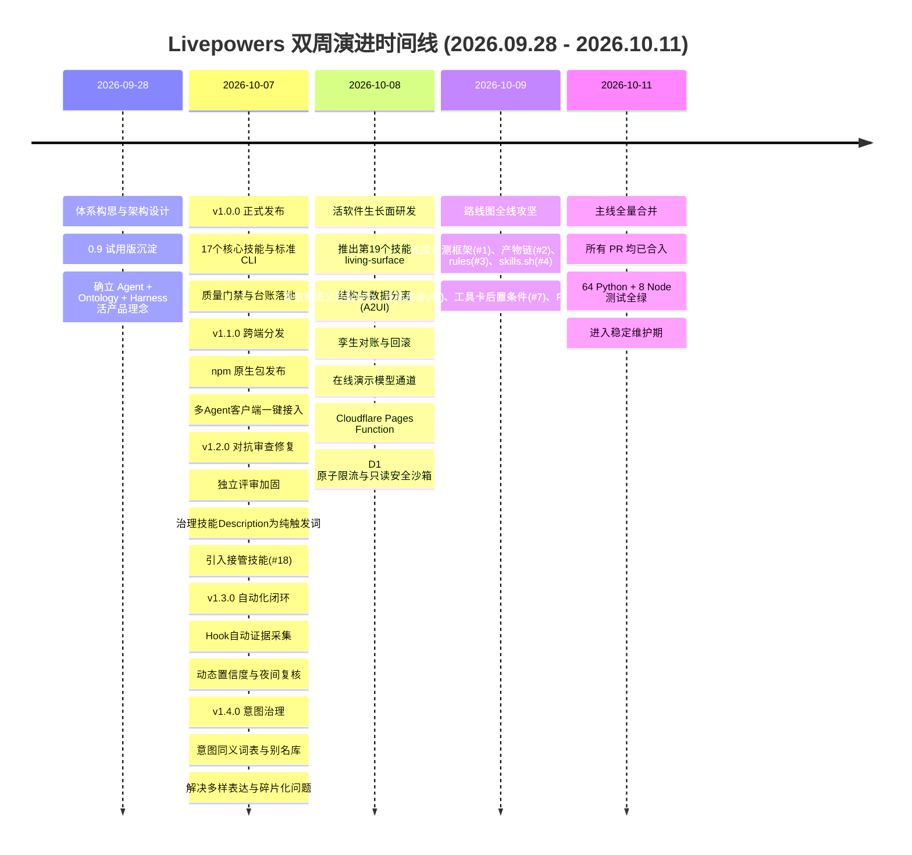

# Livepowers 双周研发进展周报 (2026.09.28 - 2026.10.11)

- **统计周期**：2026-09-28 至 2026-10-11
- **核心原则**：全栈零外部第三方依赖（Python 3.9+ / Node 原生）
- **范式基石**：Agentic AI = Agent + Ontology + Harness

---

## 核心指标与交付速览

| 指标维度 | 达成结果 | 说明 |
| :--- | :--- | :--- |
| **路线图 Issue 解决率** | **100% (9/9)** | Issue #1 ~ #9 规划任务全部实现并通过审查合入主线 |
| **核心技能库规模** | **19 个** | 新增 `living-surface` 等关键技能 |
| **全套自动化测试** | **72 项** | 64 Python + 8 Node 测试保持 100% 通过率 |
| **技能触发评测准确率** | **100% (57/57)** | 覆盖 19 个技能的正例 Top-2 命中与反例排斥 |

---

## 一、双周综述与核心成果

在过去的双周内（2026.09.28 - 2026.10.11），项目完成了从早期 0.9 试用版向工业级技能体系的完整跨越，发布了 v1.0 至 v1.4 共五个关键版本，并在近期攻坚并合入了重大架构创新**「活软件生长面（Living Surface）」**与路线图全量功能。

1. **发布与分发体系健全**：发布 npm 官方安装包，支持 Claude Code、Cursor、Codex 及通用 Agent Skills 规范的多端一键部署。
2. **活软件生长面落地**：实现从“次抛分析展示”到“自动对账并长成固化结构”的飞轮闭环，并对齐 A2UI 规范。
3. **路线图全量清零**：Issue #1 至 #9 所有路线图规划事项已**全部开发完成并合入主分支**。

---

## 二、关键里程碑与版本演进时间线



---

## 三、核心技术创新专题

### 1. 活软件生长面（Living Surface）与双轨飞轮
传统的 Agent 方案要么停留在对话框输出一次性图表（次抛分析，成本高且不稳定），要么需要沉重的人工前后端重构。活软件生长面构建了一条标准化的蜕变流水线：

```text
次抛展示 (Ephemeral) ➔ lp surface record ➔ 申请固化 ➔ lp surface promote ➔ 孪生演练与对账 ➔ lp surface reconcile ➔ 带回滚安全部署 ➔ lp surface deploy ➔ 固定页目录 (Fixed)
```

- **结构与数据严格分离**：展示面只定义组件（kpi / table / bar / line / filter）与只读 SQL，页面端绝不执行模型生成的脚本代码；
- **对齐 A2UI 规范**：内置转换器将展示面编译为标准 A2UI v0.9.1 消息流（createSurface / updateComponents / updateDataModel），支持异构宿主直接渲染；
- **沙箱与确定性验证**：页面端集成纯前端 SQLite (sql.js) 运行真实查询，服务端集成 D1 原子限流与防通配符 / 敏感字段拦截。

### 2. 纯数学、零依赖语义匹配与三态路由
在不引入外部向量库与大体积模型的前提下，依托字符集合 Jaccard 与中文双字滑窗重叠度度量算法，在 `lp registry find` 中落地了高效的三态执行闭环：
- `退出码 0 (HIT)`：严格命中已固化能力 ➔ 直接走 System 1 执行（若有固定页则直接打开，避免重复推理）；
- `退出码 3 (MAYBE HIT)`：语义推测可能命中 ➔ 提示核对前置条件，严禁盲目执行写操作；若适用可通过 `lp intents alias` 补录别名，不适用再转 System 2；
- `退出码 2 (MISS)`：未命中 ➔ 转入 System 2 探索并记录证据。

### 3. 全环境原生 Hook 自动证据采集
- **Claude Code**：通过 `PostToolUse`（监控 Bash）与 `Stop` 钩子，无感截获 S1 运行结果与 S2 探索消耗；
- **Cursor**：适配官方 `afterShellExecution` / `stop` / `sessionEnd` 钩子标准，映射会话标识与执行状态；
- **Codex**：提供 rollout JSONL 日志监听机制，按 `call_id` 配对工具调用与结算，实现多端一致的证据沉淀。

### 4. 离线多方言 DDL 环境扫描
- 扩展 `scripts/scan_sqlite.py` 与 `skills/env-scan-ontology`，纯用标准库正则表达式实现了对 **PostgreSQL** 与 **MySQL** 离线 DDL 文件的静态语法分析；
- 零依赖提取表结构、视图定义、主键、外键约束、枚举值与字段注释，自动生成本体草稿（`ontology.draft.yaml`）与环境结构指纹。

---

## 四、质量工程与评测体系建设

1. **技能描述触发精度评测机制**：
   - 编写 `scripts/eval_triggers.py` 自动化评测脚本与 `tests/triggers/*.jsonl` 用例库；
   - 遵循严谨的测试标准：每个技能配备至少 3 条真实正例与 2 条相近混淆反例；
   - **评测达标标准**：正例必须在 Top-2 触发候选中命中，反例绝对不允许作为 Top-1 误触发；
   - **评测现状**：当前全库 19 个技能共 57 条正向场景、38 条反向场景，**Top-2 正例触发率 100%，反向排斥率 100%**。
2. **测试完备性保障**：
   - **Python 测试**：涵盖评分数学模型、路由器、看板状态机合法性、止损约束、资产四道门、DDL 扫描与指纹漂移、交换机中转与防篡改、展示面对账与回滚等 64 个测试；
   - **Node 测试**：涵盖 npm 安装包打包内容隔离性、多客户端安装清单写入与幂等卸载、页面端 SQL 安全过滤、D1 原子限流等 8 个测试；
   - **跨平台兼容**：针对 macOS / bash 3.2 变量展开兼容问题进行定向修复并合入主线。

---

## 五、路线图交付清单清点

| Issue 编号 | 任务方向 | 交付内容与分支/PR | 状态 |
| :--- | :--- | :--- | :--- |
| **#1** | 评测与质量 | 技能触发率自动评测与用例集（PR #16） | **Closed (已合入)** |
| **#2** | 流程与数据 | 规格产物链与夜间稳定任务 ID 契约（PR #14） | **Closed (已合入)** |
| **#3** | 客户端分发 | Cursor 安装生成 `.cursor/rules/livepowers.mdc`（PR #12） | **Closed (已合入)** |
| **#4** | 生态分发 | 遵循 skills.sh 规范并提供 `skills.json` 清单（PR #18） | **Closed (已合入)** |
| **#5** | 检索与固化 | 零依赖纯数学语义检索与 `MAYBE HIT` 退出码 3（PR #19） | **Closed (已合入)** |
| **#6** | 技能规范 | `fde-delivery` 技能瘦身并拆分为独立工作流与参考（PR #13） | **Closed (已合入)** |
| **#7** | 工具卡治理 | 工具卡增加 postconditions 与 forbidden_actions 约束（PR #11） | **Closed (已合入)** |
| **#8** | 环境扫描 | 补充 PostgreSQL 与 MySQL 离线 DDL 扫描器（PR #15） | **Closed (已合入)** |
| **#9** | 闭环自动化 | 证据自动采集机制扩展至 Cursor 与 Codex（PR #17） | **Closed (已合入)** |
| **#21** | 活软件突破 | 活软件生长面、次抛展示、孪生对账与在线演示（PR #23） | **Closed (已合入)** |
| **#25** | 环境兼容性 | 修复 macOS/bash 3.2 下变量展开崩溃问题（PR #25） | **Closed (已合入)** |

---

## 六、下阶段工作展望

1. **业务实景验证**：持续收集次抛展示向固定页生长的实际业务用例，积累更多跨业务领域的本体模板。
2. **跟踪 A2UI v1.0 协议**：密切跟进 A2UI 规范终稿演进，确保展示面转换层平滑升级。
3. **丰富静态方言解析**：评估并支持常见 OLAP 引擎（如 ClickHouse 等）的离线 DDL 提取。
